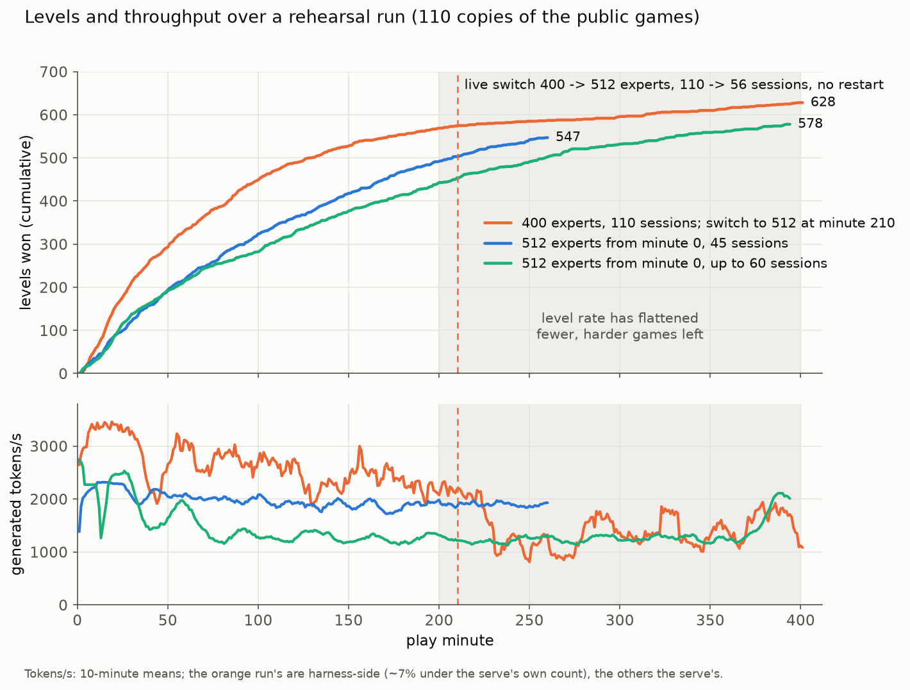

# Let the model tell you where the compute goes

### A 512-expert LLM agent at 110 concurrent sessions on one GPU for ARC-AGI-3 — public leaderboard rank 6 of 5,073 (54.55)

Grigoriy Zatravkin, with Florencia Solange; deepdreamer and aizealotwu on fine-tuning. Built on Daniel Franzen's
published milestone-2 agent and Tufa Labs' Duck harness.

---

## TL;DR

- **ARC-AGI-3 scores actions, not tokens.** A level is worth `min(115, (human/agent actions)^2 * 100)`, weighted by
  depth; the tokens the agent spends thinking before each action cost nothing on the score. Under a fixed budget —
  one RTX PRO 6000, nine hours, 110 hidden games — the score is bounded by how many tokens of deliberation the
  hardware can produce per game. **Throughput is the budget.**
- **A decode step is mostly fixed cost.** On our serve a step costs ~36.5 ms plus ~0.40 ms per concurrent session
  (four lane counts, fit residuals under 1.6 ms), so aggregate throughput keeps growing almost linearly until ~90
  sessions. The problem was a memory problem first (how many sessions fit), a scheduling problem second (how much
  of the GPU is spent re-reading prompts), and a kernel problem last.
- **We took one GPU from ~600 generated tokens/s at 10 sessions (the published milestone-2 serve) to ~3,500 at 110
  sessions** on agent traffic, by fitting 110 sessions into it: a
  400-of-512 expert cut ordered by the router's own usage, int4 KV, a host-RAM KV tier whose GPU hot region is
  filled by the sparse-attention indexer's own picks, resumable sessions, CUDA graphs for mixed steps, a tuned MTP
  drafter and a dozen SM120 kernels.
- **Speed bought with quality is worth nothing.** The first time throughput doubled, the board moved by 0.04. Every
  later gain had to pass a quality gate — KL against the unmodified model over 537K reply tokens, compared with the
  model's own noise floor — and then a behavioural check, because a per-token metric passed a change that broke whole
  replies. Reverting the lossy settings in the last week took the board from ~40 to 50.48.
- **Speed early, quality late, inside one run.** Early in a run many games are easy and every session pays; late,
  most sessions are stuck on hard levels and the level rate flattens. We built a **live expert switch**: the serve
  starts on the 400-expert cut with 110 sessions, and when the run reaches its late phase it drains the tail of its own
  KV pool, copies the 112 cold experts per layer into that memory and unmasks them in the router — without a restart —
  then plays on with 45 sessions on the full 512-expert model. Our best entry before the switch read 50.48; the entry
  with it read **54.55**, our final public score.
- **The model tells you what it reads.** The sparse-attention indexer picks ~2,048 KV rows per layer per decode step;
  logging those picks costs nothing and shows which parts of a 118K-token agent prompt the model actually consults.
  It reads its own reasoning and the tool outputs, and numbers in them; it reads the board images at less than half
  and the instructions at less than a third of their share of the prompt. The router is the same kind of signal for
  experts. Both decided where our memory went.

---

## 1. The setting

| | |
|---|---|
| Hardware | one NVIDIA RTX PRO 6000 Blackwell (96 GB, SM120), ~180 GB host RAM, no network |
| Budget | 540 minutes of wall clock for 110 hidden games; one scored submission a day |
| Model | Qwen3.8-Flash-Next, Intel AutoRound W4A16: 48 layers, 36 Gated-DeltaNet (linear attention with a recurrent state) and 12 sparse full-attention layers; 512 routed experts per MoE layer, top-10 routing; an MTP draft head |
| Agent | Daniel Franzen's published milestone-2 agent (a tool-using reasoning agent with board images, frame diffs and a Python sandbox), with our changes |
| Serve | vLLM 0.30 with ~250 patches of ours, all switchable by environment knobs and logged when they fire |

Each game is one long conversation: the agent reads a rendering of the board and its history, thinks, calls tools,
acts, and the next turn appends a few hundred tokens to a context that grows to 100K+ tokens. 110 such
conversations run at once, one per game.

## 2. Why throughput is the lever (the theory)

**The score does not price compute.** ARC-AGI-3 measures efficiency in *actions*: a level is worth
`(human actions / agent actions)^2`, so every wasted action is punished quadratically, while every token spent
deciding on the next action is free. For an LLM agent that means more deliberation per action is pure gain until
the model stops improving its decisions. Within a fixed nine-hour budget the only way to buy more deliberation is to
produce more tokens per second.

**A decode step is mostly fixed cost.** Measured on our serve (soak load, full CUDA graphs, four drafted tokens):

| concurrent sessions | 30 | 55 | 80 | 104 |
|---|---|---|---|---|
| decode step, ms | 47.1 | 60.0 | 69.5 | 76.7 |

A straight line fits these to within 1.6 ms: **step ≈ 36.5 ms + 0.40 ms × sessions**. Each session gets ~3 tokens a
step (one verified plus accepted drafts), so throughput ≈ 3n / (36.5 + 0.40n) tokens per ms. It reaches half its
asymptote at n ≈ 92 sessions. At 10 sessions the GPU spends 90% of each step on work that does not depend on how
many sessions are in it — reading 40 GB of expert weights, launching ~1,700 kernels. Every extra session that fits
in memory rides on that cost almost for free.

Three consequences ordered our work:
1. **Memory first.** Throughput is set by how many sessions fit, and a session at 100K context is several GB of KV.
2. **Scheduling second.** A prompt re-read from scratch costs prefill that produces no new tokens; mixed
   prefill/decode steps cost 1.3–3.4× a decode step (a 1–128-token prefill makes a step 102.8 ms against 79.9).
3. **Kernels last.** A kernel that saves 1 ms saves ~1.3% of a step.

**And throughput only counts if the model still behaves the same.** Section 9 is about how we found that out.

## 3. The path, in five phases

Every number below is a scored hidden-set submission (55 public games of the 110).

| phase | dates | what changed | board |
|---|---|---|---|
| 0. Harness work on Duck | Aug–Sep | perception, memory, prompts, delegation; 34 agent variants | 0.96–7.22 |
| 1. Speed bought with quality | Sep 8–16 | 320-expert cut by weight saliency: 25 GiB freed, KV 8→30 GiB, 2.1× tokens/s | 2.96 and 1.97 for the same kernel |
| 2. Quality first | Oct 8–11 | Franzen's agent, full 512 experts, int8 KV, 25 sessions; then the usage-ordered 400 cut | 22.75, 23.46, 21.48, 26.06 |
| 3. Lossless speed | Oct 14–30 | host KV tier, resumable sessions, graphs, drafter, kernels; 110 sessions | 25.72 → 40.63 → 45.02 → 47.19 |
| 4. Back to quality | Oct 31–Nov 1 | lossy settings reverted (int8 recurrent state, packed state, trim holes); live switch to 512 experts | 50.48 → **54.55** |

Two lessons are in this table. Phase 1 doubled throughput and moved nothing: the saliency-ordered cut drifted 3.54×
the model's noise floor and, on another model, cost 30% of the levels (61 against 87, sign test p = 0.007). Phase 2
showed the other side: on the clean serve the same agent won 41% more levels at an equal number of tokens. From then
on a speed change had to arrive without moving the model, and phases 3 and 4 are that rule applied twice — first by
finding speed that is lossless, then by spending the margin on quality.

The noise matters for reading this table. One unchanged bundle drew 22.75 and 23.46 on consecutive days; another
drew 21.48 and 26.06; early on, 2.96 and 1.97. Between Aug 18 and Sep 1 fourteen single-knob submissions read
0.82–1.93 and were all noise. A single draw cannot resolve an effect much smaller than its own spread, so we
attributed offline, on recorded sessions, and sent the strongest bundle to the board every day.

## 4. Memory: fitting 110 sessions on one GPU

### 4.1 An expert cut chosen by the router

The W4A16 model is 81.05 GiB on the GPU; at 512 experts the KV pool left for sessions is a few GiB. Cutting 112
experts per layer to 400 brings the weights to 66.42 GiB. **Which** experts to cut is the whole question:

| 400-of-512 cut ordered by | KL vs full model | × noise floor | ΔNLL |
|---|---|---|---|
| router usage on agent traffic | 0.0204 | **1.50×** | +0.0061 |
| weight saliency | 0.0481 | 3.54× | +0.0436 |

(9 recorded agent turns, 536,834 reply tokens; floor = the full model against itself at the same sampling, KL 0.0136.)

The usage order counts the router's real `topk_ids` on our own agent traffic and keeps what the agent actually
routes to. On the traffic it was ranked on, the usage-ordered 400 redirects 1.2% of routing; the saliency-ordered
400 redirects 10.3%, and a random 400 ~22%. Deeper usage cuts cost progressively more (375: 1.80× the floor, 350:
2.14×). A cut is also cheap to serve wrong: the first one missed the
MTP head's own experts, and any cut silently disabled a vendor fast path whose verification could not see it. We
cut at load time from byte ranges of the checkpoint, so one dataset serves every cut.

### 4.2 Quantized KV

Two formats, both read by our sparse-attention kernels: per-token-per-head int8 (1,040 bytes a token a layer
against 2,048 for BF16) and int4 with a randomized Hadamard rotation (~540 bytes). The pool grew from 1,983,247
tokens (int8) to 3,562,666 (int4). int4 KV is a real approximation — 2.2× the floor on its own — and we kept it
because the memory it buys is what lets 110 sessions resume instead of re-prefilling. The indexer's keys are FP8.

### 4.3 A host-RAM KV tier whose hot region is filled by the model's own attention

Each of the 12 full-attention layers is *sparse*: a lightweight indexer scores every past token and the layer
attends to the top ~2,048 KV rows. That makes a two-tier cache natural. The full KV of every session lives in
84 GiB of pinned host memory; the GPU keeps a **hot region** of 12,288 rows per session and layer. Each step the
indexer's picks are resolved against the hot region and the misses are copied over PCIe.

The design numbers came from the picks themselves (Section 11). Replayed on 13,824 recorded steps, LRU eviction
misses 6.6% of the union of picked rows at 12,288 slots; the clairvoyant Belady policy misses 4.8%, and frequency
policies do no better than LRU. Misses at step t+1 are mostly *new* picks (88% were not picked at step t), so no
cheap prefetch rule finds them: fetching what earlier layers picked this step covers 43.5% of misses at 2.7%
precision.

Three changes made the tier cheap enough for 110 sessions: one flat copy launch for all sessions that reads runs of
adjacent rows as whole 128-byte lines (0.705 → 0.565 ms a launch, byte-identical); a hash lookup instead of a sort in
the resolve step (together with the flat copy, the resolve wait fell from 5.01 to 2.49 ms at 110 sessions); and
issuing the decode-side gather before prefill attention in mixed steps, so the copy hides under prefill GEMMs.

### 4.4 Embeddings, vocabulary and weights: compress what is rarely read

The model's per-layer embedding (PLE) table is ~95 GiB — larger than the GPU. It lives in pinned host RAM, and the
rows the model actually reads are served from a 1M-row GPU cache. We built it twice: first as a lossless
DFloat11-style store (each BF16 row keeps its sign and mantissa bytes; the exponents, ~2.6 bits of entropy, are a
length-limited canonical Huffman stream decoded by a Triton kernel), then as 6-bit codes with a scale per 64 values,
baked once into datasets and loaded pre-quantized. The 6-bit store is what ran in the scored submissions; it is an
approximation whose drift we did not measure on its own. The token embedding follows the same pattern: the table stays in
pinned host memory and the 8,192 hottest rows live on the GPU, with lookups equal to `F.embedding` bit for bit. The
hot-row cache freed ~78 GiB of host RAM that the KV tier then used.

Two smaller lossless reductions follow the same idea. The vision tower, which runs once per board image, keeps its
BF16 weights in a compressed format (an exponent codebook plus escapes) decoded inside the GEMM loader: slower per
call, but its memory goes to the KV pool. And the output head computes logits only over the 144,289 of 248,320
vocabulary rows that agent text can use; on 2,015,790 recorded reply tokens the restricted head forbids none, the
top-5 probability mass it removes is under 10⁻⁶ a position, and padded to a multiple of 256 it runs in 1.24 ms
against 1.60 for the stock head.

### 4.5 A hybrid model has its own memory rules

vLLM gives attention blocks and Gated-DeltaNet state blocks one page size. Quantizing the recurrent state to int8
left more than half of every state block as padding; packing two layers' states per block halved the state's share
of the pool (~2,090 blocks against ~4,100 for the clean BF16 state). We later turned both off on quality grounds
(Section 9).

Two other properties of the hybrid model shaped the serve. *A prefix can only be reused where a recurrent state was
saved*: unlike attention KV, the DeltaNet state at token t is one tensor that summarizes everything before it, so a
cached prefix is usable only at a boundary where that state was registered. The scheduler therefore stops prefill
chunks at registered boundaries, keeps a spare state block for a decoding request approaching its next boundary,
and makes vLLM's prefix-retention interval work for the recurrent groups. *Speculative decoding multiplies state*:
verifying four drafted tokens normally needs a state per draft position. Our verify runs from the request's running
state with per-draft records and commits only the accepted prefix, so each request keeps one state block per group.

## 5. Which experts the agent needs

The router is the model's own statement of which experts a token needs, so we asked it twice.

**Counting.** A serve patch adds the real `topk_ids` of every MoE call into one count vector per layer and writes
the tally to the log. The first count — 50,000 layer calls, ~2.1M routed tokens per layer, Duck's agent on four
games — decided the 400 cut. A second, larger trace replayed 34 recorded conversations from 25 games through the
full 512-expert model at its native top-10 routing: 2,054,643 tokens, every token labelled by kind (reasoning
1.02M, image 308K, user text 214K, system 188K, tool output 184K, tool-call code 131K), with zero misaligned
tokens against the recording.

**Routing is concentrated.** In a median layer the top 64 of 512 experts take 46.8% of the picks (uniform routing:
12.5%), the top 128 take 68.2%, the top 400 take 98.9%. The most concentrated layers are in the middle (layers 15 and
31: 69.5% and 68.7% in the top 64); the flattest is layer 0 (31.2%). A median layer has ~98 experts used at less
than a tenth of a uniform share.

**Experts specialize by kind of token, not by game.**

| comparison | top-100 expert overlap (Jaccard, mean over 48 layers) |
|---|---|
| one game against another | 0.66 (0.47–0.79 over 300 pairs) |
| half the games against the other half | 0.88 |
| image tokens against tool output | 0.48 |
| reasoning against tool-call code | 0.29 |
| reasoning against image tokens | **0.26** |

Jensen–Shannon divergence of a kind's routing against all traffic is 0.05 for reasoning, 0.10 for tool output, 0.14
for code, 0.15 for images and system text; between two games it is 0.03. Summed over layers, 7,944 of the 24,576
layer–expert pairs take at least half their mass from reasoning tokens and 3,113 from image tokens. Image tokens
route through fewer experts: at layer 47 their effective number of experts is 56 against 148 for reasoning. Prompt
and generated tokens differ too (JS 0.13, rising to 0.22 in the last layer).

**Why it matters for a cut.** A cut ranked on one kind of traffic is a cut of the experts the other kinds need. Our
400 cut was ranked on text-only traffic at contexts up to 32K. On the held-out games of the second trace it
redirects only 0.76% of the routing of *generated* tokens, but 3.25% of the routing of *prompt* tokens — 14.8% in its
worst layer — and the image tokens are where it loses most. Ranked on the mixed traffic instead, the same 400
redirects 1.77% of prompt routing and 0.74% of generated; the weight-saliency order redirects 14.3% and 7.5%. The
saliency cut that cost 30% of the levels was not unlucky: it removed experts the agent's traffic uses.

**The order of the cold experts.** The live switch (Section 10) opens all 112 cut experts at once. Its staged
variant (410, then 430, then 512 experts) opens them in the same usage order, most used first, so each partial stage
restores the experts that carry the most routing.

## 6. Scheduling for agent traffic

**Resumable sessions instead of stateless requests.** An agent turn is a long conversation plus a short append. Each
conversation keeps one paused request in the engine; the next turn extends the held sequence instead of re-reading
the prompt. This has to be exact — the engine must see the same token history the client would send — and our
first version was not: the harness dropped blank lines from the reasoning it put back into the history, so every
resumed turn diverged from the held one and re-prefilled. Replaying 1,027 recorded requests, the fix took
re-prefills of a closed session from 555 to 0. On clean runs 92–100% of turns resume.

**A resumed session must read exactly what the client sends.** Holding a session means the engine keeps its own
tokens for the agent's last reply, and the next request carries the client's version of the same reply. The two
differ in three ways, and each one changed what the model read:

- *The harness edits its history on purpose*: it strips blank lines from reasoning, stubs degenerate or dead
  reasoning, closes replies that were cut at the length limit. A server that keeps its own reply tokens silently
  undoes those edits.
- *Generated ids are not the canonical tokenization of their own text.* The tokenizer would encode the decoded
  reply differently from the ids the model sampled; re-tokenizing the server's ids changes 0.73% of them (21,953
  tokens from 15 runs). Serializing structured content also has to be canonical: in one rebuilt prompt, 273 tokens of
  the tools header differed from the served ids only by JSON key order.
- *Images need their own key.* Every image arrives as the same run of placeholder ids, so a router matching on token
  ids alone let one game resume another game's session.

The first version — keep the server's reply tokens, resume whenever the prompt extended the previous one — cost the
agent real levels: over 19 games carried to 30K tokens it read −8.8 levels against the author's own per-game mean
(t = −3.2), while the same serve with the view off read −4.8 (t = −1.4, inside the author's spread). A resumed session
is also not numerically identical to a fresh prefill: the decode path's KL against the reference was above a fresh
prefill's in 20 of 24 probes (p = 0.001), 0.027–0.058 against floors of 0.013–0.020 at 23K–74K context.

The shipped rule makes the session a pure cache. A turn resumes after the client's re-rendered reply only if that
reply *decodes to the same text* as the server's reply tokens (a text guard, not an id match), image-aware matching
keys sessions by their images, cut replies are closed the way the client closes them, and the chat template's system
prompt no longer depends on the thinking flag, so the prefix is stable across turns. Anything else closes the
session and runs the client's tokens whole on the prefix cache.

**History trims are the dominant remaining prefill.** Franzen's agent trims its history from ~118K to ~59K tokens.
A trimmed request no longer extends the paused session, so the serve re-reads ~57K tokens. All 110 games reach the
trim within the same 20 minutes of a run, and generation falls from ~3,700 to ~2,100–2,700 tokens/s while prefill
runs at 6–8K tokens/s. We built "trim holes" — keep the recurrent state, drop the cut text from the attention KV —
which removed the re-prefill, and then reverted it on quality grounds (the recurrent state still remembers the
cut text; Section 9).

**Prefill hold with adaptive release.** Small prefills interleaved with decode create expensive mixed steps. The
scheduler holds waiting prefill while sessions decode and releases it when the token budget fills or when a cost
model fitted live says waiting costs more than merging. Mixed steps fell from 42.7% to 30.3% of all steps (measured
between two runs that also differed in trim holes, so the share is not attributed to the hold alone).

**Full CUDA graphs for mixed steps.** 3,130 of 3,136 mixed steps replayed a graph; throughput at 37 sessions went
from 430 to 611 tokens/s on the full 512-expert model.

**A processor-only multimodal cache.** The agent sends a board image every turn. Keeping the image cache only in the
API process removed a class of cache-desynchronization failures: they appeared in 0 of 212 runs with the change,
against 5 of 62 without.

**The client counts too.** The harness re-rendered the whole board history every turn; late in a game that paused
each session ~12.7 s between turns, during which its GPU seat did nothing. Rendering each board once fixed it.

## 7. Speculative decoding tuned to the workload

- **MTP drafting**, four tokens a step: per-position acceptance 0.75 / 0.56 / 0.41 / 0.31 at 110 sessions.
- **A fine-tuned draft head** (albucino's drafter, retuned on our agent traffic against the 400-expert target).
- **A restricted draft vocabulary** of 42,059 tokens built from what the agent actually generates; the drafter
  samples only over those columns, and its head runs in FP8 (drafter time −0.36 ms a decode step on the live serve,
  for −0.1% accepted tokens).
- **Sampled drafting and block verification.** The drafter samples instead of taking its argmax and keeps its
  distribution, so verification is true rejection sampling; on top of that we enabled vLLM's block verification
  (accepting a drafted block jointly rather than token by token). On a live serve, over 31,696 sampled verifications,
  blocks accepted 3.2304 tokens a step against 3.1953 token by token on the same draws (+1.1%).
- **Verification over the top 32 logits** instead of the full 248K-wide vocabulary row: sampler time a step 2.684 →
  0.342 ms, zero mismatches on 480 rows.
- **Draft depth by measurement.** At 110 sessions and ~32K context a fourth draft adds 10% tokens a step and 10.6% to
  the decode step: a wash. A fifth raised tokens per verify step by 7.6% and lost on pure decode.
- **Built and left off:** a relaxed acceptance rule, a per-session draft budget chosen by drafter confidence, staged
  early stopping of the draft, and suffix drafting from the agent's own history (at most +3.6%).

## 8. Kernels on Blackwell (SM120)

Kernel work came last on purpose, and its numbers deserve care: most were measured on an isolated bench, and on the
live serve several changed at once. The table says which.

| kernel | isolated measurement | on the live serve |
|---|---|---|
| Marlin MoE top-k summing epilogue (fp32 atomics fold the reduction into the second expert GEMM) | 0.504 → 0.439 ms a layer at 2,041 rows | mixed step MoE −2.87 ms, with other changes |
| Sparse-attention indexer, compact launch grid (row tiles of all requests back to back, not requests × longest) | — | mixed indexer 7.17 → 5.08 ms, with other changes |
| Gated-DeltaNet verify with a lookahead load | −7.6 … −21.8% a layer at 1–5 tokens, bit-exact | −0.76 ms a step at 95 sessions |
| Router, shared-expert gate and gate/up stacked into one GEMM | −0.44 ms a step at 110 rows | −1.26 … −1.31 ms with five changes |
| W4A8 on the MoE path (int8 activations, signed group scales) | 1.04× the drift floor | shipped |
| FP8 for the Gated-DeltaNet projections | 1.22× the floor | shipped (FP8 for attention projections, 1.53×, was not) |
| Lean sparse-attention prefill | 2.02× a layer | mixed-step attention 40.99 → 25.31 ms between two runs |
| HyperConnection decode projection on cuBLAS instead of the fused kernel | — | −0.35 ms a decode step |
| Split-K Triton BF16 GEMM at the row counts where cuBLAS falls into slow bands | per shape | shipped |
| Full CUDA graphs for mixed steps, with the speculative verify inside the graph | — | 430 → 611 tokens/s at 37 sessions |

Several kernel ideas moved nothing or lost on the live serve: pinning router and dense weights in L2 (no decode timer
moved), an L2 prefetch of the next MoE layer (+1.2 ms a step, worse), our own Triton grouped-MoE kernel in place of
Marlin, and a rewrite of the DeltaNet verify in CUDA (faster, rejected on quality; Section 9). The day's kernel work
against a matched load once moved the step by about 1% (91.90 against 92.84 ms at 110 sessions, 50K context).
Kernels were never where the factor of six came from.

## 9. The quality gate, and what it rejected

Every change passed a gate in two parts.

1. **Distribution drift.** KL divergence of the next-token distribution against the unmodified model on recorded
   agent turns (537K reply tokens from nine games), compared with the *noise floor* — the reference against itself
   under the same sampling. A change is described as a multiple of that floor.
2. **Behaviour.** Recorded agent sessions replayed and read: malformed tool calls, replies that end inside the
   reasoning block, re-prefills, levels at an equal token budget.

What the gate rejected or rolled back:

| change | speed | drift | why it went |
|---|---|---|---|
| batch-shared experts | +11.7% decode at 50 sessions | 2.90× | drift |
| top-9 / top-8 routing | — | 2.12× / 3.85× | drift |
| FP8 dense everywhere | — | 2.96× | drift |
| CUDA rewrite of the DeltaNet verify | 10–19% faster a layer | — | malformed tool calls 0.29% → 0.78% of replies |
| int8 recurrent state | ~2,000 pool blocks freed with packing | **1.01×** | replies ending inside the reasoning block ~3× as often |
| int6 KV + 4,096-row hot window + 2,048-token step | 110 sessions, ~10% fewer tokens/s | — | 2 levels by minute 7 against 50: malformed tool calls |
| trim holes | removed the trim re-prefill | — | the recurrent state keeps the text the trim removed |
| 3-bit experts | ~25% fewer expert bytes | — | built, never passed to a scored run |

The int8 recurrent state is the lesson. Its per-token drift was indistinguishable from the floor, and it still
broke the agent: at temperature 1.5 the replies that end inside the thinking block became about three times as
frequent, and each one costs a turn. **A per-token metric cannot see a sequence-level failure.** Only reading what
the agent did showed it.

In the last week we reverted the int8 state, the state packing and the trim holes together. Our best entry before
the revert read 47.19; the bundle with the clean serve read 50.48 (it also carried agent-side changes). The clean
serve costs almost nothing until the history trims arrive, and then pays the re-prefill of Section 6.

## 9a. What we changed in the agent

The agent is Daniel Franzen's published milestone-2 agent; our changes to it are small next to the serve, and all of
them are in `bundle/harness_presets/legacy/`:

- **Byte-identical requests.** Each board image is rendered once and cached, so a turn's request repeats the earlier
  turns byte for byte — which is what lets the serve resume the held session — and the client no longer pauses
  ~12.7 s a turn late in a game.
- **History kept as served** (`ARC3_VERBATIM_REPLY`): the reasoning the model wrote goes back into the history
  unedited, so the next turn extends the session instead of re-reading it (Section 6).
- **Action economy in plain sight.** Franzen's lines that tell the model how many actions earlier levels took and how
  many this level has taken so far were missing from our builds for two weeks; we restored them. A RESET has to carry
  a stated reason.
- **"Let me reconsider."** When the agent has spent 80,000 tokens and 20 actions on a level without winning it, the
  next turn's thought is opened for it with the words *Let me reconsider*, and again every 20,000 tokens. It costs
  nothing: the request ends with an assistant message holding those words as the start of its reasoning, and a chat
  template patch (`open_last_thinking`) continues inside the open `<think>` block instead of closing the turn. Both
  selected submissions carry it. We measured it on 36 saved game states where the agent was stuck, 45 minutes each,
  on a clean serve: two identical arms with the opener won 9 and 9 new levels, the arm without it 11; the two
  identical arms disagree on 3 states each way, so the stand's noise is about ±3 states. An earlier stand with three
  phrases put *Let me reconsider* ahead of *Step back* and *Hypothesis* (13 levels against 9 and 9), inside the same
  noise. On this evidence the opener is harmless and its benefit unresolved; the stands also used a different
  trigger (40+ actions, at most once per 25 actions) than the submissions.
- **Scheduling across games** (54.55 submission only): when the live switch sheds sessions, the copies with the
  largest share of their game already played are parked first, and freed seats go to the copies with the most left.

## 10. From speed to quality inside one run: the live expert switch

The same trade that phases 1–4 made over three months also exists inside one nine-hour run. Early, many games are
easy, each of the 110 sessions wins levels, and throughput is worth the most. Late, most sessions are stuck on hard
levels or finished; the level rate flattens and what is left needs better decisions, not more of them.

Rehearsals on the public games (110 copies: 25 games × 4 plus 10) show both halves. On the 400-expert cut with 110
sessions the run wins 210 levels in its first 30 minutes and 104 in the next 30; by minute 180–200 it wins ~22 per 30
minutes, and after minute 200 one run added 59 levels in 200 minutes (569 → 628) while its serve still generated
1,400–2,500 tokens/s. **Throughput stopped converting into levels.**

A model with all 512 experts is the better decision-maker — the 400 cut sits at 1.50× the floor — but it does not fit
beside 110 sessions, and early in the run sessions are what pays:

| play minute | 30 | 60 | 120 | 180 | 240 |
|---|---|---|---|---|---|
| 400 experts, 110 sessions (levels) | 212 | 334 | 489 | 554 | 582 (switched to 512 at 210) |
| 512 experts from minute 0, 45 sessions | 122 | 221 | 362 | 468 | 532 |
| 512 experts from minute 0, up to 60 sessions | 138 | 217 | 326 | 415 | 480 |
| tokens/s: 400 / 512@45 / 512@60 | 3,278 / 1,937 / 1,812 | 3,103 / 2,006 / 1,689 | 2,758 / 1,942 / 1,383 | 2,429 / 1,897 / 1,187 | — / 1,847 / 1,278 |

(The 400-expert tokens/s are harness-side, ~7% under the serve's own count; the others are the serve's.)

More sessions on the full model is worse, not better: at 60 sessions the KV pool sat at ~100%, 417 paused sessions
were closed under memory pressure by minute 100 (one on the 400 cut), and each turn re-read 6.3K prompt tokens against
2.8K. The full model wants fewer sessions with room to keep them; the cut model wants many sessions early.

So the serve changes model in the middle of the run, without a restart:

1. **At load** it serves the 400-expert cut, and in the background builds the 112 cold experts of every layer from
   the checkpoint into the Marlin format the kernels read (~13 GiB, written to local disk). It self-checks one
   rebuilt kept expert against the served codes byte for byte. The router is widened to 512 rows at once, with the
   cold rows held at a large negative logit, so routing is unchanged until the switch.
2. **At the switch** the harness sheds sessions down to 45 — parking the copies with the largest share of their game
   already done, and giving freed seats to those with the most left — and the scheduler drains the tail of the KV
   pool (~7,000 blocks), preempting the few requests that hold it.
3. **The worker copies the cold experts into that memory**, which is reinterpreted as expert weight views, and
   unmasks their router rows. The cold experts run as a second Marlin call through an expert map and are summed with
   the kept ones. The copy moves 12.79 GiB in 24.5–30 s; with a 15-second drain stall the whole switch completed 95 s
   after it was asked, and 45 sessions were generating 2.1–2.3K tokens/s three minutes later.

Our final public entry switched at play minute 360. Before the switch our best entry read 50.48; with it, **54.55**.

*Figure 1. Cumulative levels (top) and generated tokens/s (bottom) on 110 copies of the public games. The 400-expert
run with 110 sessions is ahead from the first minutes and stays ahead; by minute ~200 its level rate has flattened
while it still generates 2,000+ tokens/s, and at minute 210 it switches live to 512 experts. The full model served
from minute 0 never catches up within 400 minutes, and it does worse with more sessions (green) than with fewer
(blue), because 60 sessions fill its KV pool.*

The schedule can be smarter than a fixed minute, and the run can measure its own plateau. Our last submission made
the switch adaptive: 410 experts at load, 430 once 15 games had finished, and 512 when the level rate plateaued —
from minute 180, checked every five minutes, switching when the levels won in the last 30 minutes fell to 8% of the
levels won in minutes 30–60, twice in a row, and at minute 360 at the latest — with the context budget raised to 150K
after the switch. On the rehearsal in Figure 1 that rule fires at minute 245 (8 levels in 30 minutes against 122 in
minutes 30–60). That submission read 41.34; it also changed five agent-side settings, and its first stage takes KV
memory at 430 experts while ~100 sessions are still playing, which is where the load would choke first.

## 11. What the model reads: attention picks as a free profiler

A sparse-attention indexer is an interpretability instrument that the model runs for you. At every decode step,
in each of the 12 attention layers, it scores every token of the context and picks the ~2,048 rows it will attend to.
The picks are already computed; logging them costs nothing. We dumped them for one long agent request — 118,173
prompt tokens, 111 messages, the 12 main attention layers, 49 consecutive decode positions, 1.2M picks — and
labelled every prompt token by where it came from.

**What the model reads, against what the prompt holds:**

| segment | share of picks | share of prompt |
|---|---|---|
| the model's own earlier reasoning | **51.9%** | 42.2% |
| tool output | **25.0%** | 17.6% |
| tool-call code it wrote | 10.5% | 10.4% |
| board images | 5.6% | 12.5% |
| user text (instructions, game frame text) | 3.8% | 12.7% |
| system prompt | 2.2% | 3.9% |

- **It reads its own notes.** Reasoning and tool output — the record of what it tried and what happened — take 77%
  of the picks. The board images get less than half their share, the instructions less than a third.
- **It reads numbers.** Tokens holding a digit are 25.2% of non-image picks against 16.6% of non-image prompt
  tokens. The recalls are scattered: coordinates, not whole boards (runs of a median 4 tokens; 0.1% of missed tokens
  sit in runs of 64 or more).
- **It reads recent text densely and old text sparsely, but it does read it.** The last two messages take 35.2% of
  picks at 1.9% of the prompt; picks 64K or more tokens back are 22.1% of the total against 45.8% of the prompt. The
  long context is used, thinly.
- **Depth changes what is read.** Layers 3–15 spend 75% of their picks on the model's reasoning; layers 19–47 spend a
  third on tool output, and 27–30% of their picks hold a digit.
- **There is little attention-sink behaviour** in this sample: the first 128 tokens get 0.8% of picks; only 56 tokens
  are picked in at least 90% of layer-steps, 52 of them reasoning.

What we did with it: the hot region's size and eviction policy (Section 4.3) were chosen on recorded picks, and the
same data killed several prefetch ideas before they cost a GPU-hour. It also explains a negative result we had no
explanation for: changes to the board image channel (outlines, renders, a perception scout) never moved the score,
and the model barely looks at the image tokens once a game is under way — what it consults is its own written
account of the board.

**Limits.** This is one request from one game at one context length, at the start of one reply. The shares above are
a measurement of that request, not a law of the model. The router trace of Section 5 — 2.05M tokens from 25 games —
points the same way from the other side: image tokens route through a small, separate set of experts, and reasoning
tokens through the widest one.

## 12. How we worked

- **Measurement before spending.** GPU time was the scarcest resource. Changes climbed a cost ladder: unit tests, a
  stub server, one paid game, three games, a 25-game rehearsal. Recorded requests were replayed offline. An archive
  of ~900 runs answered most questions before a GPU-hour was spent.
- **Attribution off the board.** With a draw spread comparable to most single improvements, the daily submission
  carried the strongest bundle and attribution happened on recorded sessions.
- **Every patch announces itself.** Each serve change is an environment knob, logs a line when it fires, and has a
  self-check that falls back to stock on a mismatch. A startup line proves installation only, so the shipped patches
  log when they fire; 336 of 492 archived serve logs carry patch lines, 102 serve-hours in total, up to 117
  concurrent sequences.
- **AI-assisted engineering.** The project ran as a team of Claude Code agents, each owning a component (the host KV
  tier, the MoE and indexer kernels, the sampler, the scheduler) under written rules; hooks blocked GPU spend nobody
  had approved, and every reported number was re-derived from its artifact before it entered the findings file.

## 13. What generalizes

1. **For agent workloads, KV residency is the product.** Session hold, prefix reuse and a host tier mattered more than
   any kernel.
2. **Let the model allocate.** The router's usage chose the experts; the indexer's picks sized the hot region; the
   level rate chose when to trade sessions for experts. Each signal is free, and each beat the hand-designed
   alternative (weight saliency, frequency eviction, a fixed model for the whole run).
3. **Measure quality where the user sees it.** A per-token divergence passed a change that broke whole replies.
4. **Build the step model first.** Two numbers — fixed cost and cost per session — told us which lever was worth
   pulling for three months.
5. **Treat evaluation noise as a first-class quantity.** If one run cannot resolve an effect, a leaderboard cannot
   either.

## 14. Code, reproduction and credits

- Code: this repository — the agent harness, the serving patches and kernels, the submission notebook.
- The serve runs on vLLM 0.30 with the patches in `serving/`; every knob of the 54.55 submission is in
  `bundle/serve/pureallk400fast_setup.sh`, and the live switch is `serving/expert_hot.py`. The 50.48 submission
  is in `submissions/vh1104-v1/`.
- Model: `dfranzen/intel-qwen3.8-flash-next-w4a16-autoround`; drafter `dfranzen/albucino-qwen3-8-flash-next-drafter`.
- Team: Florencia Solange ran experiments on her GPU quota, tuned the draft head and benchmarked the agents;
  deepdreamer and aizealotwu joined late and worked on fine-tuning.
- Built on: Daniel Franzen's milestone-2 agent and model packaging, Tufa Labs' Duck harness, Intel AutoRound,
  albucino's MTP drafter, vLLM.

---

## Appendix A. Every patch module of the 54.55 serve

One row per module of `serving/` (a `*_table.py` source edit is grouped with its helper). *On* means a knob that arms it is set in `bundle/serve/pureallk400fast_setup.sh`; *off* modules shipped in the dataset but did not run in the scored submission. *Exact* means the same math as stock vLLM (bit-exact where a test checks it); *approximate* changes the numbers and passed the drift gate of Section 9.

### Memory and weights

| module | what it changes | in the 54.55 serve | kind |
|---|---|---|---|
| `bf16c.py` | Lossless compressed-BF16 dense-weight GEMM (packed bits + exponent + escape list, decoded inside Triton GEMM/decode kernels; MIX/FAST2/PIPE variants), applied to listed groups | on: `BF16C=1` | exact |
| `embed_hot.py` | Token-embedding table in pinned host RAM with the 8192 hottest rows (special ids first) on GPU; lookup equals F.embedding bit for bit | on: `EMBED_HOT=8192`, `EMBED_HOST=1` | exact |
| `expert_cut.py` | Cuts 512 experts to the top-K by usage at load: reads only kept rows' byte runs with coalesced multi-worker reads, never writing a pruned copy | on: `EXPERTS_KEPT=400`, `EXPERT_CUT_AT_LOAD=1`, `EXPERT_CUT_WORKERS=32` ... | approximate |
| `expert_hot.py + expert_hot_table.py` | Hot-switch: at runtime rebuilds kept experts from the checkpoint (go-file) to switch the served expert set / MOE_SILU premix epilogue without restart; self-checks cold call vs served expert through Marlin | on: `EXPERT_HOT=1`, `MOE_SILU_EPI=1` | approximate |
| `fp8_dense.py` | Online-quantizes dense BF16 linears to FP8 per-channel (PTPC) or block128 at load; marks layers for the Triton band | on: `FP8_TRITON_BAND=2560x6144:257-576` | approximate |
| `fp8_triton_band.py` | Routes an FP8 dense linear of a given NxK shape to a Triton kernel only inside a row-count band | on: `FP8_TRITON_BAND=2560x6144:257-576` | approximate |
| `vllm-patches/ (apply_radixark_nvfp4_ple_fp8_patch.py, radixark_nvfp4_ple_fp8.patch, PATCH_IDENTITY.json, README.md)` | Pinned-hash patch letting the NVFP4 RadixArk checkpoint's PLE embedding use the existing global-scale FP8 PLE loader; gated on env + config SHA-256; no lookup/forward change | off | exact |
| `humming_int3.py + humming_int3_table.py (quantization/auto_gptq.py)` | Serves MoE experts at 3 bits through humming (uint3, group scales by least-squares); re-quantizes at load | off | approximate |
| `mem_offload.py` | Offloads embeddings (EMBED_HOST/EMBED_HOT=8192 hot rows) and vision tower to host, sizes the KV pool from measured facts (KV_AUTO plan/fingerprint, KV_CACHE_MEMORY_BYTES) and prints a GPU memory ledger | on: `EMBED_HOST=1`, `EMBED_HOT=8192`, `KV_AUTO=1` ... | exact |
| `mtp_weights.py (+MTP_WEIGHTS inline patch in serving_setup)` | Swaps the MTP draft model's tensors at load for ours (dense + int4 experts safetensors) | on: `MTP_WEIGHTS=drafter_h200_snapB_dense....` | approximate |
| `vision_weights.py (+inline patch)` | Swaps the checkpoint's vision tensors for a replacement file | off | approximate |
| `ple_hot.py (PLE tiers)` | Per-layer-embedding (n-gram) table of ~95 GiB held off-GPU: row cache, RAM tier and disk tier, pre-resolve of PLE rows inside captured graphs | off | exact |
| `ple_hot.py / ple_packed.py DF11 (PLE_DF11)` | Stores the PLE table with bf16 exponents Huffman-coded (DFloat11 style), staged GPU decode, startup encoder with 32 threads | on: `PLE_DF11=1`, `PLE_DF11_ASYNC=1`, `PLE_DF11_STARTUP=1` ... | exact |
| `ple_hot.py PLE_QSTORE / QHOT (int6 store, GPU hot rows)` | Quantises PLE rows to 6-bit codes (bake in parts) and serves hot rows from a 1,048,576-row GPU copy via gather launch | on: `PLE_QSTORE=int6`, `PLE_QHOT=1048576`, `PLE_PACKED=1` ... | approximate |
| `ple_packed.py` | Gather kernels for packed PLE rows | on: `PLE_PACKED=1` | exact |
| `ple_df11_bake.py` | Offline/startup bake of the DF11 PLE file (parts, probes) | on: `PLE_DF11=1` | exact |
| `ple_host.py` | Exact-size pinned host allocation for INC-quantised PLE (PLE_EXACT_PIN) | on: `PLE_EXACT_PIN=1`, `QUANTIZATION=inc` | exact |
| `ple_prefill_grouped.py + ple_group_patch.py + ple_graph_table.py` | Grouped short-conv prefill for PLE layers with capped slots (replaces dense per-prefill block); table wraps graph capture of PLE layers | off | exact |
| `shard_prefetch.py (WEIGHTS_PREFETCH)` | Background reads safetensors shards into page cache ahead of the loader window (/proc-followed), skips files the packed table replaces | on: `WEIGHTS_PREFETCH=8`, `WEIGHTS_PREFETCH_GIB=24` | exact |
| `slim_state.py + slim_state_table.py` | Mamba/GDN state-block accounting plus softer release: PLE_RIDE, KEEP_SOFT pins, TAIL_SOFT reserve, WAIT_KEEP (move cached blocks of waiting requests to eviction-queue back), WAIT_ORDER (serve fewest-uncached-tokens first) | on: `TAIL_SOFT=hard` | scheduling |
| `weight_checksum.py` | Per-tensor / model digest helpers used by the WEIGHT_CACHE checksum RPC | off | diagnostic |

### KV cache and sparse attention

| module | what it changes | in the 54.55 serve | kind |
|---|---|---|---|
| `hisparse_invalidate_table.py (v1/hisparse/runtime.py; kernel in taaf_small_kernels)` | Fuses the HiSparse invalidate (searchsorted / index_select) into one kernel | on: `HISPARSE_INVALIDATE_FUSED=1` | exact |
| `host_kv.py` | Pure-torch planner of the host-RAM KV tier: hot-state, LRU eviction keys, plan(), hisparse budget and lanes_that_fit sizing | on: `HOST_KV=1`, `HOST_KV_ROWS=9984` | exact |
| `host_kv_table.py (qwen4_exp/nvidia/qsa.py)` | Wires the QSA attention layer to the host-KV tier (KV cache spec, hot region, resolve) | on: `HOST_KV=1` | exact |
| `host_kv_fused.py (2724 lines, Triton)` | Fused residency resolve + gather + copy path: one-launch/one-hash resolve, FLAT_COPY (one kernel for all lanes' misses, 128-byte line reads, 96 programs), SPILL_TRUST, GATHER_EARLY (decode gather issued before prefill attention, also inside captured mixed steps), HITS_FIRST, HOT_KEEP/RELEASE | on: `HOST_KV_FUSED=1` | exact |
| `host_kv_resolve_cuda.py + host_kv_resolve.cu` | CUDA (nvcc, NVRTC fallback) version of the one-launch resolve, verified against the Triton resolve on a cloned world | on: `HOST_KV_ONE_CUDA=1` | exact |
| `kv_rebase.py` | Rebase of cached int4-quantized keys to a new position: RoPE shift via Hadamard-rotated dequant, re-quantize, so a trimmed context keeps its prefix cache; several pieces flagged MISSING in the file itself | off | approximate |
| `qsa_hisparse.py: HiSparse host-KV tier core (HOST_KV, GROUP, ADMIT, HOT_ROWS, HOLD_CLEAN)` | Patches vLLM HiSparse: full KV of every session in 84 GiB pinned host RAM; per-lane GPU hot region of 12,288 rows; picks resolved against it, misses gathered; admission by real block counts | on: `HOST_KV=1`, `HOST_KV_GIB=84`, `HOST_KV_ROWS=9984` ... | exact |
| `qsa_hisparse.py flat copy` | One kernel copies all lanes' misses; runs of 4 adjacent 544 B rows read as whole 128 B lines | on: `HOST_KV_FLAT_COPY=1` | exact |
| `qsa_hisparse.py ONE_LAUNCH / ONE_HASH / SINGLE_FUSED / PLAN_FUSED / PLAN_AHEAD` | Residency decision, plan, tally and copy plan in one launch; per-lane open-addressing hash instead of a sort | on: `HOST_KV_ONE_LAUNCH=1`, `HOST_KV_ONE_CUDA=1` | exact |
| `qsa_hisparse.py spill trust / skip / one-sort / flag` | Skip extra spill resolve passes when a lane's union fits | on: `HOST_KV_SPILL_TRUST=1` | exact |
| `qsa_hisparse.py gather early / mixed capture / hits first` | Decode gather issued before prefill attention in mixed steps (also inside captured graphs); attend hot hits while misses copy | on: `HOST_KV_GATHER_EARLY=1` | exact |
| `qsa_hisparse.py hot keep / release / split / spans` | Hot-region lifecycle for paused/resumed lanes (keep warm, release, split) | on: `HOT_KEEP=1`, `HOT_KEEP_WARM=1`, `HOST_KV_HOT_RELEASE=1` ... | exact |
| `qsa_hisparse.py HISPARSE_* (SYNCFREE, PLAN_ONCE, PLAN_ONCE_CAPTURED, COPY_ASYNC, INVALIDATE_FUSED)` | Sync-free hisparse step, plan computed once across layers (also in captured graphs), async copy streams, fused invalidate kernel | on: `HISPARSE_SYNCFREE=1`, `HISPARSE_INVALIDATE_FUSED=1` | exact |
| `qsa_hisparse.py stage (STAGE_MIB, STAGE_TILE, SPARSE_STAGE, QSA_STAGE_REUSE, QSA_STAGE_AHEAD, QSA_HALVES)` | Prefill-chunk row staging from host to GPU staging buffer; reuse across chunks (88 MiB); tile 64 | on: `HOST_KV_STAGE_MIB=320`, `QSA_STAGE_REUSE=1`, `QSA_STAGE_REUSE_MIB=88` | exact |
| `qsa_hisparse.py union bitmap/swap, indexer wide, last slice, mark fill, fresh fix, run merge, take rows` | Variants of union computation and hot-region fill | off | exact |
| `qsa_hisparse.py prefetch / spec / pick log / audit / guard` | Experimental prefetch (PREV, TAIL, SPEC), pick logging, row-attend, audit and guard checks | off | diagnostic |
| `qsa_hisparse.py misc (ADAPTIVE_VERIFY, STEP_TIMERS hooks, MIXED_FULL, REC2)` | Hooks into verify gate and timers | on: `MIXED_FULL=1` | n/a |
| `qsa_kv8.py QSA_KV8 (int8/int4 per-token-head KV)` | Serves the main QSA KV as int8 (1,040 B/token/layer) or int4 with randomized Hadamard rotation (544 B rows); per-token-head writer, sparse kernel does MMA on codes and applies scales per column | on: `KV_CACHE_DTYPE=int4_per_token_head`, `QSA_KV8=1`, `INDEXER_KV_DTYPE=fp8` ... | approximate |
| `qsa_kv8.py KV4_WRITE_FUSED` | Fused rotated-key int4 write path | on: `KV4_WRITE_FUSED=1` | exact |
| `qsa_kv8.py QSA_PREFILL_LEAN` | Lean sparse-attention prefill on quantised KV: slot pass, dense query rotation, per-row core, dense inverse rotation+gate; replaces tile-of-4-rows union kernel | on: `QSA_PREFILL=1`, `QSA_PREFILL_CONFIG=64,4,3`, `QSA_PREFILL_LEAN=1` ... | exact |
| `qsa_kv8.py QSA_DECODE_LEAN / DECODE_FUSED` | Fused int4 split-K decode, one block-table pass per row; config (block_n, splits, warps)=64,4,1 | on: `QSA_DECODE_FUSED=1`, `QSA_DECODE_LEAN=1`, `QSA_DECODE_CONFIG=64,4,1` ... | exact |
| `qsa_kv8.py tile union` | Tile-4 union for mixed steps; skip empty tiles; fused split-K | on: `QSA_TILE=4`, `QSA_TILE_SKIP_EMPTY=1`, `QSA_TILE_UNION_FUSED=1` ... | exact |
| `qsa_kv8.py QSA_UNION_DECODE / QSA_REUSE / QSA_OVERLAP` | MTP verify rows read the union of picks once; reuse picks across steps | off | exact |
| `qsa_kv8.py MTP_INDEX_ROWS / MTP_ATTN_ROWS (+ inline patch_mtp_last_rows)` | Narrow the drafter's index/attention gathers to the rows it needs (last rows) | on: `MTP_INDEX_ROWS=1`, `MTP_ATTN_ROWS=1`, `MTP_LAST_ROWS=1` | exact |
| `qsa_index_compact.py (also in qsa_kv8.py)` | Compact launch grid for the QSA indexer prefill-logits kernel: (sum of row tiles + requests) programs instead of padded (request x tile) grid | on: `QSA_INDEX_COMPACT=1` | exact |
| `qsa_graph.py + qsa_graph_table.py (MIXED_FULL)` | Bucketed full-CUDA-graph capture of mixed prefill+decode steps; indexer and attention read split/padding from device tensors; shared prep | on: `MIXED_FULL=1`, `MIXED_PREP_SHARED=1` | exact |

### Hybrid recurrent state (Gated DeltaNet / Mamba groups)

| module | what it changes | in the 54.55 serve | kind |
|---|---|---|---|
| `align_tail.py` | Scheduler: a prefill chunk stops only where a Mamba state is registered (replay boundaries, junction, prompt tail, last cacheable block), otherwise fills the token budget; stands aside if retention/coordinator disagree | on: `ALIGN_TAIL=1` | scheduling |
| `cache_keep.py` | Patches kv_cache_utils.py so the prefix-cache retention interval works with Mamba/hybrid groups | off | scheduling |
| `cache_keep_end.py + cache_keep_end_table.py` | Scheduler: gives each Mamba group a spare block while a decoding request is near its next boundary so the exact recurrent state is registered there; RAM mode keeps reply-tail snapshots in host RAM; paused-register | off | scheduling |
| `conv_syncfree.py + conv_syncfree_table.py` | Patches short_conv_attn.py to build the token-group index from device tensors, removing a host sync; self-check, stands aside on mismatch | on: `CONV_SYNCFREE=1` | exact |
| `gdn_accept.py + gdn_accept_table.py` | GDN speculative verify from the request's running state with per-draft records, committing only the accepted prefix : each Mamba cache group keeps 1 state block per request instead of 1+drafts; verify/commit CTA shapes tunable | on: `GDN_ACCEPT=1`, `GDN_COMMIT_SHAPE=32,8,1`, `PDL=1` | exact |
| `gdn_align_tiles.py + gdn_align_tiles_table.py` | Raises temporal tiles of the Mamba align pre/post-copy kernel (mamba_utils.py) so it launches more CTAs per request | off | exact |
| `gdn_ba_views_table.py` | Table patch to qwen_gdn_linear_attn.py: GDN b/a gates read as views of the fused projection instead of copies | off | exact |
| `gdn_commit_stream.py + gdn_commit_stream_table.py` | Runs GDN state commit + align postprocess on a side (optionally higher-priority) CUDA stream overlapping the main stream | off | scheduling |
| `gdn_cp_split.py + gdn_cp_split_table.py` | Changes the context-parallel chunk split in GDN chunked prefill (flashinfer gdn_prefill) from the stock token count to a finer multiple | off | exact |
| `gdn_decode_tail_table.py` | Table patch: fused-decode tail zeroing/handoff into taaf_gdn_fused in place of torch.zeros core_attn_out | on: `GDN_DECODE_TAIL_ZERO=1` | exact |
| `gdn_fused.py + gdn_fused_table.py` | Fused GDN decode/verify kernels (tiled, shape 64,2,1), commit cap, slot fill, verify-ahead, PDL prologue, optional Q8 state, lazy steps; the main GDN kernel module (3868 lines) | on: `GDN_FUSED=tiled`, `GDN_TILED_SHAPE=64,2,1`, `GDN_COMMIT_CAP=2` ... | exact |
| `gdn_meta_once.py + gdn_meta_once_table.py` | Builds GDN attention metadata once per step and shares it across all GDN builders (persistent step buffers, slices instead of host-mask gathers); device prep kernel builds state indices | on: `GDN_META_ONCE=1`, `GDN_META_SLICE=1`, `PREP_GDN=1` | exact |
| `gdn_meta_once.py + gdn_meta_once_table.py (edits v1/attention/backends/gdn_attn.py)` | All GDN layer builders read ONE set of persistent step buffers (masks, token idx, query starts, accepted counts); PREP_GDN: one kernel writes spec/plain state indices for all GDN cache groups (replaces ~15 small launches per group); META_SLICE: state indices by row slice, not host-mask gather | on: `GDN_META_ONCE=1`, `GDN_META_SLICE=1`, `PREP_GDN=1` | exact |
| `gdn_mixed_full.py + gdn_mixed_full_table.py (gdn_attn.py)` | GDN metadata builder declares mixed-batch FULL-graph support: chunk indices, causal-conv program lists and decode/prefill split built on device into persistent buffers; PREP_ONCE (block-table index built once for all GDN groups), MIXED_PREP_SHARED, LEAN tail, FI/short-prefill/HALVES/state-inplace/Q8 variants | on: `MIXED_FULL=1`, `GDN_PREP_ONCE=1`, `MIXED_PREP_SHARED=1` ... | exact |
| `gdn_norm.py + gdn_norm_table.py (qwen_gdn_linear_attn.py)` | Gated RMS norm after GDN prefill reads the output gate strided where the in-proj wrote it (no contiguous copy first) | on: `GDN_NORM_STRIDED=1` | exact |
| `gdn_prefix.py + gdn_prefix_table.py (gdn_attn.py, qwen_gdn_linear_attn.py)` | In a mixed step with spec rows leading the batch, each GDN layer slices spec+prefill tokens and writes outputs in place (no index_select/index_copy) | on: `GDN_SPEC_PREFIX=1` | exact |
| `gdn_q8_table.py (+ taaf_gdn_fused q8_inplace wrapper)` | Wraps the GDN decode kernels so the recurrent SSM state is held int8 with per-row scales | off | approximate |
| `gdn_q8_pack.py + gdn_q8_pack_table.py` | Packs two single-layer Mamba (GDN) groups into one int8-state group so two GDN layers of a lane share each state block (halves state-pool groups) | off | approximate |
| `gdn_tail_zero_table.py (qwen_gdn_linear_attn.py; helper in gdn_mixed_full)` | GDN attention output allocated empty not zeros when mixed forward owns the step; only padding rows past real tokens zeroed | on: `MIXED_FULL=1`, `GDN_DECODE_TAIL_ZERO=1` | exact |
| `gdn_tril_table.py (flash_linear_attention/ops/solve_tril.py)` | GDN prefill 64x64 triangular merge autotunes over 1-8 warps / 1-5 stages | off | exact |
| `gdn_tril_ilp_table.py (solve_tril.py)` | Four 16x16 forward substitutions in one loop, stores upper blocks as zeros itself so output allocated without a fill | off | exact |
| `gdn_verify_cuda.py (968 lines, with CUDA source)` | Hand-written NVRTC CUDA kernel for the GDN speculative verify on int8 state (rank-k update with kxk key Gram, pending corrections in closed form, 64-85 regs vs 254 Triton) | on: `GDN_FUSED=tiled` | approximate |
| `mamba_zero_table.py (single_type_kv_cache_manager.py, worker/utils.py)` | Treats Mamba blocks like attention blocks for new-block tracking and zeroes newly allocated Mamba state blocks | on: `MAMBA_ZERO_NEW=1`, `MAMBA_JUNCTION=1`, `MAMBA_COUNT_FLOOR=1` | exact |

### MoE, router and dense kernels

| module | what it changes | in the 54.55 serve | kind |
|---|---|---|---|
| `dense_hole.py + dense_hole_table.py` | Patches linear.py: at row counts where cuBLAS BF16 hits slow bands, a split-K Triton BF16 GEMM serves instead; boot self-check/tuning verdict per (N,K,rows), cuBLAS kept elsewhere | on: `DENSE_HOLE=1` | exact |
| `gemma_norm_table.py (qwen4_exp/nvidia/mtp.py; kernel in taaf_small_kernels)` | Installs a fused GemmaRMSNorm kernel for the MTP drafter | on: `GEMMA_NORM_FUSED=1` | exact |
| `hc_fused.py (1697 lines)` | Fused HyperConnection (qwen4_exp) kernels with autotune/picks file, bit-checked per shape; decode band path, mixed F1 path, UP4 tile and a cuBLAS down-projection mode | on: `HC_FUSED=1`, `HC_DECODE=300-660`, `HC_DECODE_DOWN=cublas` ... | exact |
| `l2_pin.py + l2_pin_table.py (v1/worker/gpu/model_runner.py)` | Pins router/dense weights in L2 via CUDA access-policy window around graph replays | on: `L2_PIN=96` | exact |
| `marlin_sum.py` | JIT builder (nvcc, seedable library) of a Marlin MoE w2 kernel whose epilogue atomically adds top-weighted rows into a token-indexed fp32 buffer, plus SiLU epilogue edits; 30 kernels, top-k baked in | on: `MOE_SUM_EPI=1`, `MOE_SILU_EPI=1` | approximate |
| `marlin_workspace_table.py (marlin_moe.py; helper in taaf_small_kernels)` | Reuses the Marlin MoE workspace instead of allocating per call | on: `MARLIN_WORKSPACE_REUSE=1` | exact |
| `moe_add_fused.py + moe_add_fused_table.py (model runner / MoE layer)` | Fuses the shared-expert sigmoid gate, multiply and routed+shared add into one kernel | on: `MOE_ADD_FUSED=1` | exact |
| `moe_block.py + moe_block_table.py (marlin_moe.py)` | Overrides Marlin MoE block_size_m by row-count bands; W4A8 int8 chain: ACT_QUANT, QUANT_FUSED (fused activation quant), SILU_EPI, SILU_PREMIX (w1 interleaved at load so SiLU runs in the w1 epilogue), prezero of fp32 sums | on: `MOE_BLOCK_M=1817-2072:48,2201-2328:48...`, `MOE_ACT_QUANT=1`, `MOE_QUANT_FUSED=1` ... | approximate |
| `moe_share.py + moe_share_setup.py` | Batch-aware expert re-pick of each main MoE layer's top-k under CUDA graphs (share experts across rows; top-p, group, prefill_top-k, MTP share), with a runtime "cut" to kept experts from a control file | on: `EXPERTS_KEPT=400`, `EXPERT_CUT_AT_LOAD=1`, `EXPERT_ORDER=usage` | approximate |
| `moe_taaf.py + moe_taaf_table.py (marlin_moe.py)` | Own Triton grouped MoE kernel (gate_up + down) used for a window of row counts instead of Marlin | off | approximate |
| `router_chain.py + router_chain_table.py` | Fuses router and shared-expert gate/up projections into one GEMM (cat_gate_up) before shared expert | on: `ROUTER_CHAIN=gate_up` | approximate |
| `router_fused.py` | Fused top-k softmax Triton kernel with PDL for the router | on: `ROUTER_FUSED=1`, `PDL=1` | exact |
| `router_pad.py` | Pads router logits to a width the fused top-k kernel supports (-inf columns), so 400 experts route fast | off | exact |
| `small_kernels.py + small_kernels_triton.py` | Five small fusions: draft top-k Triton kernel, Gemma-style RMSNorm fused, hisparse invalidate fused, Marlin workspace reuse, sample glue fused | on: `DRAFT_TOPK_TRITON=1`, `GEMMA_NORM_FUSED=1`, `HISPARSE_INVALIDATE_FUSED=1` ... | exact |

### Sessions and scheduling

| module | what it changes | in the 54.55 serve | kind |
|---|---|---|---|
| `mixed_full.py + mixed_full_table.py (v1/worker/gpu/model_runner.py)` | Mixed prefill+decode steps are bucketed to padded token sizes (step 128 up to 4224) and replayed as FULL CUDA graphs instead of piecewise/eager; decode/prefill split read on device | on: `MIXED_FULL=1`, `PIECEWISE_LARGE=4224`, `PIECEWISE_LARGE_STEP=128` ... | exact |
| `mixed_full_graph.py + mixed_full_graph_table.py (cudagraph_utils.py, model_runner.py)` | Graph dispatch for mixed full graphs: capture on mixed dummy batch, decode_full (decode step under a mixed bucket replays the full decode graph), pick-log streak veto, screening of broken bucket graphs | on: `MIXED_FULL=1` | exact |
| `mixed_full_spec.py (+ mixed_full_table.py spec import)` | Speculative verify inside the mixed full graph: padded-layout verify, device-resident acceptance counts, packed read-back; captured sampling tail over the top-K (SAMPLE_TOPK) target vocab, clips acceptance at stop ids like the eager PAUSED sampler; MIXED_TAIL_POOL shares tail buffers | on: `MIXED_FULL=1`, `MIXED_TAIL_POOL=1`, `SAMPLE_TOPK=32` ... | scheduling |
| `no_blank.py + no_blank_table.py` | In-graph Triton logit mask (state machine over reasoning/content/tool lines) banning blank/whitespace-only lines, leading whitespace, stray </think>; tool bodies and drafter not masked | off | approximate |
| `park.py (PARK)` | Copies a closed paused session's prefix-cached GPU blocks (at newest registered boundary) into a pinned RAM store and pins its host-pool pages; resume copies back and re-registers hashes so the next turn is a prefix hit | on: `PARK=1`, `PARK_DISK=1` | exact |
| `park.py host-disk tier` | Writes a parked session's host-pool pages to a disk file, frees host pages; resume reads back, falls back to recompute if page missing | off | exact |
| `paused.py core: session hold/resume (PAUSED)` | One live engine request per conversation, held paused; next turn extends the held sequence instead of re-reading the prompt (installed on AsyncLLM.generate) | on: `PAUSED=1` | scheduling |
| `paused.py client view` | A resumed turn continues after the client's re-rendered reply while the prompt extends the previous one; the session keeps the server's own reply tokens (guarded by the text guard below) | on: `PAUSED_CLIENT_VIEW=1`, `PAUSED_CLIENT_VIEW_SERVER_TOKENS=1`, `PAUSED_DIFF_LOG_S=30` | cache (text-equal, ids may differ) |
| `paused.py text guard + open replies` | Resume after re-rendered reply only if it decodes to the same text as server reply tokens; cut (length) replies closed the way the client closes them; stop-tail / tool-call / leading-space variants | on: `PAUSED_TEXT_GUARD=1` | exact |
| `paused.py image-aware keys + OPEN_THINK_TEMPLATE / STABLE_THINK_SYSTEM` | Image-aware session keys and the chat-template edits listed under setup | see setup rows | exact |
| `paused.py reply slack` | Extra token headroom after a session's reply so a resumed turn stays inside the held block | on: `PAUSED_REPLY_SLACK=12288` | scheduling |
| `paused.py resume-unstopped / seat pressure / pressure-memory-only / max / idle / KV-high / KV-wait` | Policy for which paused sessions are released under seat, KV or memory pressure | on: `PAUSED_RESUME_UNSTOPPED=1`, `PAUSED_SEAT_PRESSURE=1`, `PAUSED_PRESSURE_MEMORY_ONLY=1` | scheduling |
| `paused.py lean token ids` | API server and engine keep request/chunk token ids as array('I') instead of Python lists | on: `PAUSED_LEAN=1` | exact |
| `paused.py MM drop` | Frees a paused prompt's image data once the engine holds it | on: `PAUSED_MM_DROP=1` | exact |
| `paused.py pool + POOL_LEDGER + gauges` | Scheduler pool ledger every N s (free/held/evictable blocks), /metrics taaf_paused:* and taaf_pool:*, census | on: `PAUSED_POOL=1`, `POOL_LEDGER=1` | diagnostic |
| `paused.py park probe / ledger free` | Scheduler hooks tracing the free/lookup of parked requests ("PAUSED park probe") and a ledger-free pass | on: `PAUSED_PARK_PROBE=1` | diagnostic |
| `paused.py fork branches` | Requests marked as a branch of a main take the main's KV blocks (computed prefix shared); live branch carries the main's QSA indexer ring | on: `PAUSED_BRANCH=1`, `FORK_BRANCH=1`, `FORK_LIVE=1` | exact |
| `paused.py rewind / backup` | Backup of a paused session's full-attention and recurrent state at a point so a rewound turn restarts from there | off | exact |
| `paused.py trim holes (TRIM_HOLE*, ROPE_GAP, HOT_SPANS)` | Keep recurrent state, punch a hole in attention KV where the client trimmed history; retry/sync-text/reply variants; far checks; rope gap | off (`TRIM_HOLE=0`; its sub-knobs are set but inert) | approximate |
| `paused.py cause log / diff log / memtrace` | Logs why a session closed / which fresh admission / first history difference; MEMTRACE tracks RSS | on: `PAUSED_DIFF_LOG_S=30` | diagnostic |
| `prefill_hold.py + prefill_hold_table.py (fixed hold)` | Scheduler does not schedule waiting prefill tokens while sessions decode until >=T tokens queued or oldest older than W ms | on: `PREFILL_HOLD=1` | scheduling |
| `prefill_hold.py AUTO + prefill_hold_auto_table.py + inline patch_prefill_hold_auto` | Cost-aware release: hold until block-aligned prefill >= 0.9 x (budget - decode tokens) or live-fitted waiting cost exceeds mixed-step overhead F; cap 10 s | on: `PREFILL_HOLD_AUTO=1`, `PREFILL_HOLD_ALIGNED=1` | scheduling |
| `prefill_fill.py` | A prefill chunk whose budget cannot reach the next Mamba block boundary takes a sub-block chunk, next chunk realigns | on: `PREFILL_FILL=1` | scheduling |
| `prefill_wip.py` | Caps prefill tokens in flight per step (Limit, clamp/refuse tally) | off | scheduling |
| `pdl_table.py (PDL)` | Programmatic Dependent Launch (gdc wait/launch) added to Triton kernels: unified attention reduce_segments, GDN meta, attention-group utils, router | on: `PDL=1` | exact |
| `token_pin.py + token_pin_table.py` | Pins prefix-cache blocks of marked spans (marker tokens) so they are not evicted | on: `PREP_ADMIT=1` | scheduling |

### Speculative decoding and sampling

| module | what it changes | in the 54.55 serve | kind |
|---|---|---|---|
| `accept_lambda.py + accept_lambda_table.py` | Patches vLLM rejection sampler (rejection_sampler_utils.py): per-request/global accept-lambda (relaxed draft acceptance), guarded n-gram repeat window, strict verification inside tool-call ids/markers | off | approximate |
| `block_verify.py + block_verify_table.py` | Turns on vLLM 0.30 block rejection sampling (Sun et al. 2403.10444) with fresh uniforms/Gumbel noise per round, residual mass from drafter's stored top-k ids (sparse) instead of a second full-vocab pass, device-side tally | on: `BLOCK_VERIFY=1`, `DRAFT_SAMPLE=1` | approximate |
| `draft_budget.py + draft_budget_policy.py + draft_budget_kernel.py + draft_budget_table.py + draft_budget_tables.py` | Per-lane verify-row budget: drafter confidence decides how many draft rows each lane verifies (ragged verify depth) via lookup tables and a graph-safe kernel | off | scheduling |
| `draft_early_stop.py + draft_early_stop_table.py` | Staged early stop of drafting depth (stage depths/fractions; select conf/random/first) shrinking draft steps per lane mid-chain | off | scheduling |
| `draft_head_fp8.py` | Drafter lm_head over the draft vocab as e4m3 weights (per-row scales, per-token activation scales) | on: `DRAFT_HEAD_FP8=1` | approximate |
| `draft_meta.py + draft_meta_table.py` | Patches qsa_cache.py so draft steps 1+ rebuild QSA side-cache metadata in place from device tensors (one fused multi-step draft loop, no host rebuild between steps) | on: `DRAFT_FUSED_META=1` | exact |
| `draft_sample.py` | Sampled (probabilistic) drafting: drafter samples and stores draft logits/top-ids so verification is a true rejection sample | on: `DRAFT_SAMPLE=1`, `SAMPLE_TOPK_DRAFT=1`, `DRAFT_TOPK_TRITON=1` | approximate |
| `draft_sample_narrow.py` | Samples/caches drafter logits only over the narrow draft-vocab columns (rest -inf), avoiding the 248K-wide row | on: `DRAFT_SAMPLE_NARROW=1` | exact |
| `draft_topk_kernel.py` | Two-kernel Triton top-k over bf16 draft logits replacing torch.topk on a float copy; falls back if unsupported | on: `DRAFT_TOPK_TRITON=1` | exact |
| `draft_vocab.py` | Restricts drafter head/sampling to a hash-checked 42,059-token draft vocabulary (padded) | on: `DRAFT_VOCAB=1`, `DRAFT_VOCAB_PAD=64` | approximate |
| `target_vocab.py (+inline TARGET_VOCAB_FROM/TO)` | Moves 144,289 of 248,320 lm_head rows to the front, computes target logits over the kept rows only (padded to 256, persistent -inf buffer); drafter sharing the head gets token-order logits | on: `TARGET_VOCAB=1`, `DRAFT_VOCAB=1`, `DRAFT_VOCAB_PAD=64` | approximate |
| `sample_topk.py + sample_topk_kernel.py + sample_topk_table.py` | Compact in-graph sampler: top-K=32 candidate compaction for temperature/top-k/top-p, tail-kept logits, glue fused; draft sampling too | on: `SAMPLE_TOPK=32`, `SAMPLE_TOPK_DRAFT=1`, `SAMPLE_GLUE_FUSED=1` ... | approximate |
| `spec_index.py` | Counter/experiment: how well previous-layer picks or spec variants predict indexer picks (coverage/precision); optional speculative host-KV prefetch | off | diagnostic |

### Vision

| module | what it changes | in the 54.55 serve | kind |
|---|---|---|---|
| `mm_processor_only.py + mm_processor_only_table.py (multimodal/registry.py, cache.py)` | Multi-modal cache is processor-only: items kept in API process, every request ships its data, so the engine has no receiver cache to miss; clones views into batched pixel buffers | on: `MM_PROCESSOR_ONLY=1` | exact |
| `vision_cache.py + vision_cache_table.py` | Keeps encoder outputs freed by the scheduler on GPU by mm hash (up to 1024 MiB, LRU) so a re-scheduled image skips the encoder | on: `VISION_CACHE=1024` | exact |
| `vision_ahead.py + vision_ahead_table.py` | Scheduler stops a prefill chunk before an uncached image and encodes it this step; worker encodes an image beyond this step's tokens on a low-priority side stream beside the forward | on: `VISION_AHEAD=1` | exact |

### Setup and diagnostics

| module | what it changes | in the 54.55 serve | kind |
|---|---|---|---|
| `draft_capture.py` | Captures drafter inputs/hidden states + confidence from live serving to disk (rotate, GiB cap, game/lane filters) as drafter-tuning data | off | diagnostic |
| `draft_conf_log.py` | Read-only per-step histogram of drafter softmax confidence vs verifier acceptance | off | diagnostic |
| `draft_summin.py` | Read-only diagnostic scoring each verified draft position by p(greedy draft) and sum min(p, q_tau) over top-k, to estimate the sampled-drafting ceiling | off | diagnostic |
| `expert_counter.py` | Counts expert routing hits per layer (TAAF_EXPERT_SUMMARY lines) to derive the usage order for the cut | off | diagnostic |
| `init_trace.py` | Startup/import timeline tracer (events file, per-process role, aggregates) | off | diagnostic |
| `marks.py` | Brackets chosen kernels with _mark_<site>_in/_out in the profiler trace | off | diagnostic |
| `moe_identity.py` | Offline identity/error check (reference vs Marlin vs moe_taaf) for 512 and 400 expert layouts; run from serving_setup as a subprocess | off | diagnostic |
| `moe_route.py + moe_route_setup.py` | Logs per-layer routing to a route file and can re-pick experts under a control file (trace replay); installer arms it | off | approximate |
| `step_timers.py + step_timers_table.py` | One-thread kernel at each group boundary reads %globaltimer and accumulates spans into a GPU ring, captured in every CUDA graph; read by non-blocking copy and logged; PREP segment split | off | diagnostic |
| `vision_tally.py` | Counters of vision encoder time/tokens in mixed steps | off | diagnostic |
| `serving_teardown.py` | End of serve: shuts down helpers, writes summary of tallies; carries default env (MTP_TOKENS=4, MAX_NUM_SEQS=117, KV bytes 28,806,644,240, int4 KV, prefix caching, MAX_NUM_BATCHED_TOKENS=4224, graph capture size 592) | on: `MTP_TOKENS=4`, `MAX_NUM_SEQS=117`, `MAX_NUM_BATCHED_TOKENS=4224` ... | n/a |
| `serving_setup.py: OPEN_THINK_TEMPLATE (OPEN_THINK_FROM/TO)` | Chat template: a request whose last message is the assistant's and which asks open_last_thinking continues inside `<think>` with its reasoning_content instead of closing the turn | on: `OPEN_THINK_TEMPLATE=1` | exact |
| `serving_setup.py: STABLE_THINK_SYSTEM (STABLE_THINK_FROM/TO)` | Chat template: reasoning-effort line opens the system message whether or not thinking is enabled (``), so prefix is stable across turns | on: `STABLE_THINK_SYSTEM=1` | exact |
| `serving_setup.py: WEIGHT_READ_FROM/TO (EXPERT_CUT_AT_LOAD, EXPERT_HOT)` | Wraps vLLM's safetensors reader so only the kept 400 experts' byte ranges are read, in usage order; EXPERT_HOT loads cold experts beside the cut view for the live 400 -> 512 switch | on: `EXPERT_CUT_AT_LOAD=1`, `EXPERTS_KEPT=400`, `EXPERT_ORDER=usage` ... | approximate |
| `serving_setup.py: MTP_LOAD_FROM/TO (MTP_OWN_READS)` | Draft model reads its own weights through the cut-aware reader | on: `MTP_OWN_READS=1` | exact |
| `serving_setup.py: DRAFT_VOCAB / TARGET_VOCAB / MTP_WEIGHTS / VISION_WEIGHTS _FROM/_TO` | Inline model-file edits to load restricted vocab (draft, target), swapped drafter and vision tensors | on: `DRAFT_VOCAB=1`, `DRAFT_HEAD_FP8=1`, `TARGET_VOCAB=1` ... | approximate |
| `serving_setup.py: SCHED_RESERVE/REMAINING/HELPER _FROM/_TO (SCHED_SPEC_RESERVE)` | Scheduler admission reserve counts speculative tokens | on: `SCHED_SPEC_RESERVE=1` | scheduling |
| `serving_setup.py: OFFLOAD_LOAD_FROM/TO (OFFLOAD_LOAD_SYNC)` | Synchronous launch_copy in the KV offload worker load path | on: `OFFLOAD_LOAD_SYNC=1` | exact |
| `serving_setup.py: PIECEWISE_DRAFT_ANCHOR (PIECEWISE_LARGE, SHARED_STREAM_TOKENS)` | Piecewise graph manager sizes up to 4224 step 128; shared-expert runner on side stream above 600 tokens | on: `PIECEWISE_LARGE=4224`, `PIECEWISE_LARGE_STEP=128`, `SHARED_STREAM_TOKENS=600` | exact |
| `serving_setup.py: inline found/put patches: ALLOC_GUARD, BLOCK_COPY_CHUNK_MIB, MAMBA_COUNT_FLOOR, ALIGN_TAIL, CACHE_KEEP (+MATCH_UNIT), PREFIX_RETENTION` | KV cache manager allocation guard, chunked block copy (64 MiB), Mamba block-count floor, scheduler tail alignment, prefix-cache keep policy edits | on: `ALLOC_GUARD=1`, `BLOCK_COPY_CHUNK_MIB=64`, `MAMBA_COUNT_FLOOR=1` ... | exact |
| `serving_setup.py: inline found/put patches: BLOCK_VERIFY, RELAX_ACCEPT, ACCEPT_LAMBDA, ADAPTIVE_VERIFY, DRAFT_CONF_LOG` | Rejection-sampler edits: block verification (sparse residual), relaxed acceptance, adaptive verify gate, draft confidence log | on: `BLOCK_VERIFY=1`, `DRAFT_SAMPLE=1`, `DRAFT_SAMPLE_NARROW=1` ... | approximate |
| `serving_setup.py: inline found/put patches: FP8_DENSE (gdn, ptpc), FP8_TRITON_BAND, W4A8 tails, HC_FUSED, BF16C, MM_PROCESSOR_ONLY, L2_PIN, EMBED_HOST/EMBED_HOT, MEM_LEDGER` | Online FP8 dense for GDN projections with Triton band 2560x6144:257-576; hyperconnection BF16 fused; BF16 compute groups; processor-only MM cache; persisting L2 96 MiB; host embeddings with 8,192 hot rows; memory ledger | on: `FP8_DENSE=gdn`, `FP8_DENSE_QUANT=ptpc`, `FP8_TRITON_BAND=2560x6144:257-576` ... | approximate |
